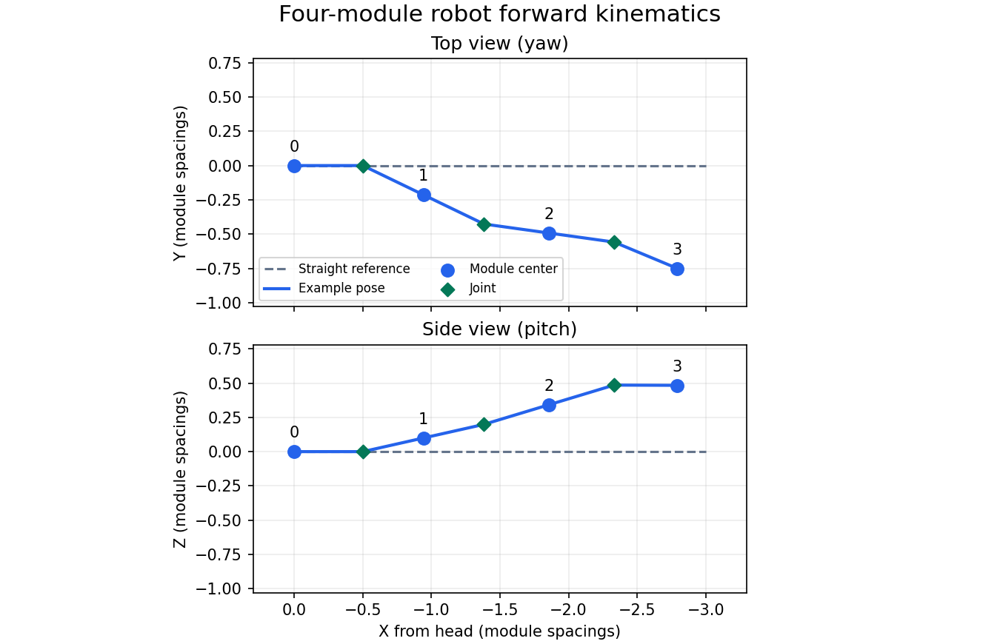

# Modular Robot Kinematics

A runnable geometric model based on my forward-kinematics work for Virginia Tech's modular snake robot senior design project. My contributions also included ROS 2 model checks in RViz and preliminary CAN message design for commands, feedback, and faults.



**What to look for.** The top view shows how yaw bends the chain horizontally. The side view shows the height changes from pitch. The plotted points come directly from the Python model and use normalized module spacing.

This portfolio example uses equal module spacing and a head-fixed coordinate frame. Each connector rotates about local yaw, then local pitch. The model returns module centers and joint locations. It models geometry only. It has no dynamics, wheel contact, or hardware control.

The Python demo was prepared with AI assistance as a companion to the original MATLAB work.

Run with Python 3.10 or later. The demo prints the four module centers for a three-joint pose, and the checks verify a straight pose, rotation order, and module spacing.

```sh
python kinematics.py
python kinematics.py --check
```
